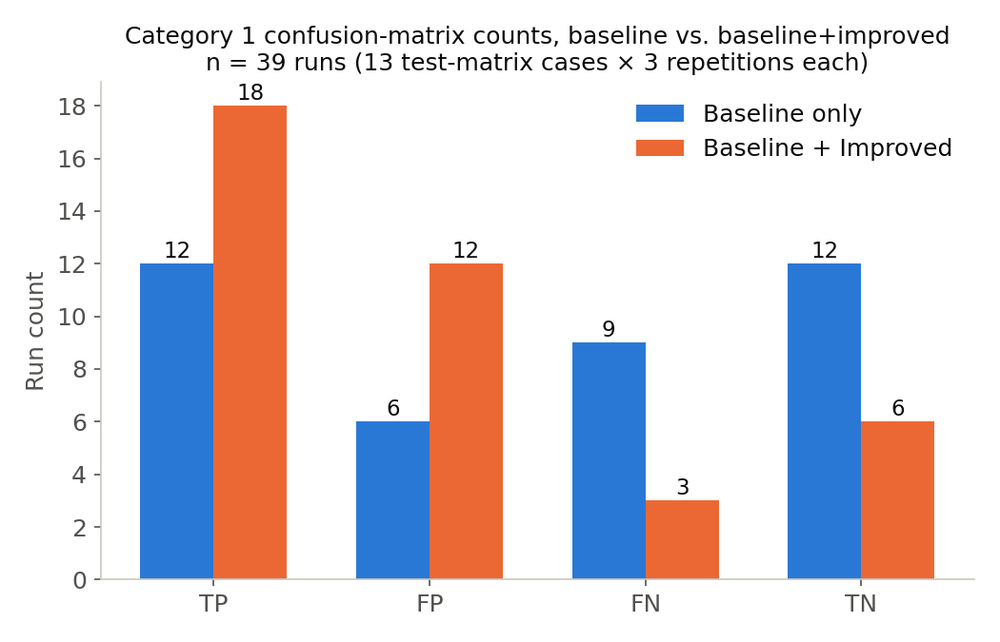
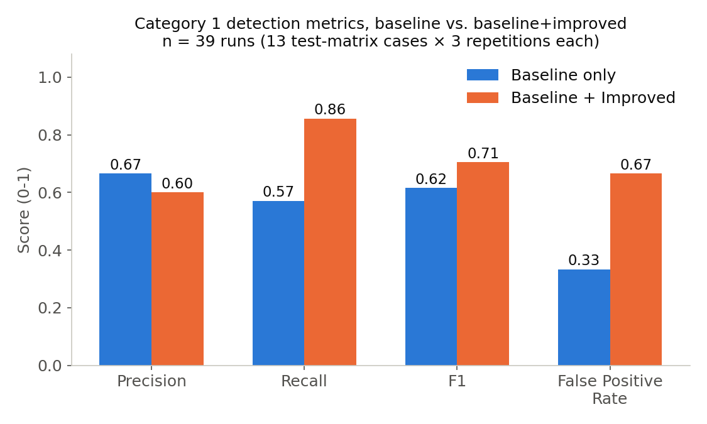

# Category 1 Report: Detecting In-Pod Behavior with Falco

**Project:** Practical Cloud Security PBL — Category 1 (in-Pod behavior detection) only. Categories 2 and 3 are separate projects and out of scope here.
**Testbed:** https://github.com/cclab-inu/Practical-Cloud-Security-PBL (upstream, read-only reference — never pushed to).
**Scenario basis:** all attack scenarios simulate post-compromise behavior from the 2024 OpenMetadata RCE campaign on Kubernetes (per Microsoft Threat Intelligence's public analysis), reproduced as lab-local file/process side effects only — no real exploit, malware, network reverse shell, or credential exfiltration is used anywhere in this project.

This report consolidates material developed and measured across Phases 0-5 (full detail in the individual `docs/` and `results/` files it cites) into a single problem → method → implementation → results → errors → limitations narrative.

---

## 1. Problem

Falco observes raw kernel syscalls (via `modern_ebpf`) and matches them against declarative rules. The testbed ships 6 baseline rules (`category1/falco-values.yaml`) built around four specific attack-replay scripts (`category1/*.sh`). A natural question for any syscall-matching detector is: **how tightly are these rules bound to the exact scripts they were written against, and what happens to detection quality when an attacker performs the same underlying technique with a trivially different filename, interpreter, or tool?**

This project's research question: *how often do process/filename-bound baseline rules miss realistic variants of the same attack technique, and how many false positives do the broader conditions needed to catch those variants introduce against legitimate activity that happens to share the same syscalls?* Both sides of this tradeoff are measured with the same pre-registered test matrix and the same evaluator — not asserted independently or argued qualitatively.

## 2. Method

### 2.1 Ground truth and test design

Each test case's expected class (`benign`/`malicious`) is fixed **at design time**, from what the action actually is and its intended purpose — never read back from whether a current Falco rule happens to match it. This is the core safeguard against circular evaluation. The full design, with rationale per case, lives in `tests/test_matrix.csv` and `tests/README.md`.

13 cases total:
- 4 **baseline replays** (the original `normal.sh`, `abnormal_1.sh`, `abnormal_2.sh`, `abnormal_3.sh`, unmodified).
- 4 **hard-normal / attack-variant cases** designed before any rule change, specifically to probe the baseline's filename/tool binding (`development` split — inspectable before rule design).
- 3 more **attack-variant** cases exercising different interpreters/tools (`development` split).
- 2 **holdout** cases (`malicious_credential_existence_probe`, `malicious_token_decoy_path`), deliberately not executed or inspected until the final Phase 5 scoring run, to guard against unconsciously tuning rules to cases we had already seen.

### 2.2 Evaluation unit and metrics

The evaluation unit is **one case execution (case × repetition)**, not one alert line. A single real action can legitimately produce more than one alert line (see §5, cross-node duplication and the `abnormal_3` outer/inner wrapper artifact) — these are deduplicated (`scripts/parse_falco_events.py`) before any TP/FP/FN/TN decision.

Per-case, the specific rule(s) that count as a positive signal are pre-registered (not decided after seeing results). Definitions:
- **TP**: malicious case, valid run, expected positive signal fires.
- **FN**: malicious case, valid run, no matching positive signal.
- **FP**: benign case, valid run, a positive signal fires anyway.
- **TN**: benign case, valid run, no positive signal.
- **Invalid**: the action or the observation could not be trusted (non-zero exit code, Falco pod not ready, collector gap) — excluded from the TP/FP/FN/TN denominator entirely, never forced into FN/TN.

Metrics (N/A when the denominator is 0, never silently treated as 0): Precision = TP/(TP+FP), Recall = TP/(TP+FN), F1 = 2TP/(2TP+FP+FN), False Positive Rate = FP/(FP+TN). Full rationale in `docs/methodology.md`.

### 2.3 Repetition policy

Each case is run 3 times (after an initial smoke run) as a determinism check, not as a statistically powered sample. All 39 executions in the final run (13 cases × 3 reps) were valid and every case was perfectly deterministic across its 3 repetitions — reported as such, not generalized into a larger-N claim.

## 3. Implementation

### 3.1 Environment

kind cluster `pbl-security`, 3 nodes (Docker containers sharing one host kernel), Cilium CNI, Falco 0.45.2 (`modern_ebpf` driver) as a DaemonSet across all 3 nodes. Full measured versions and topology in `docs/environment.md`.

### 3.2 Baseline rules (unchanged, frozen, hash-verified)

The 6 original rules (`PBL Normal Configuration Read`, `PBL Normal Temporary File Activity`, `PBL Normal Curl Health Check`, `PBL OpenMetadata Environment Discovery`, `PBL OpenMetadata ServiceAccount Token Access`, `PBL OpenMetadata Payload Execution`) were left byte-for-byte unmodified throughout the project. A frozen copy and SHA-256 hashes of both the local values file and the rule content as mounted inside a running Falco pod are recorded in `docs/environment.md` and `rules/baseline_falco_values.yaml`, so the "before" state of this project is independently verifiable.

Static predictions for each baseline scenario, later confirmed live 3/3 deterministic repetitions, are in `docs/baseline_analysis.md`.

### 3.3 Improved rules (additive, deployed alongside the baseline, never replacing it)

Two new rules in `rules/improved_falco_values.yaml`, designed directly against the two confirmed baseline false negatives (full rationale, including deliberately-not-fixed limitations, in `docs/rule_rationale.md`):

- **PBL Improved Script Execution From Tmp** — generalizes "a shell runs a script from `/tmp`" to any of Falco's stock `shell_binaries`, keyed on the *actually executing* process's own arguments (not a parent's command line). Fixes both the different-filename and different-interpreter baseline misses. Measured, accepted tradeoff: it also fires on two deliberately-designed legitimate `/tmp`-script cases — this is the central, honestly-reported cost of the broader rule, not an oversight.
- **PBL Improved ServiceAccount Token Access Any Tool** — same credential file-path condition as the baseline, but accepts any reading tool, not only `cat`. Deliberately leaves the path-matching condition itself untouched, so the holdout case below remains a meaningful, unbiased test of that specific logic.

### 3.4 Evidence pipeline

- `scripts/collect_falco_logs.sh` — tails each Falco pod's JSON log with `--since-time` (bug-fixed, see §5) to a per-node file.
- `scripts/run_baseline_case.sh` — runs one case, records start/end timestamps and exit code to a manifest CSV, never echoes script output.
- `scripts/parse_falco_events.py` — parses the JSONL evidence, windows each run between its own start/end (capped at the next run's start, see §5), deduplicates cross-node echoes, and counts per-rule alerts per run.
- `scripts/metrics.py` / `scripts/evaluate_matrix.py` — turn raw per-run alert counts into TP/FP/FN/TN classifications and Precision/Recall/F1/FPR, under two pre-registered positive-rule-set views ("baseline-only" vs. "baseline+improved").
- `tests/test_evaluator.py` — 14 unit tests covering the evaluator's edge cases (empty log, dedup logic both ways, malformed JSON, window boundaries, invalid runs, zero-denominator metrics) — all passing before any of this logic was trusted on real evidence.

## 4. Results

Full detail, per-case classification table, and the two measured confusion matrices: `results/phase5_evaluation.md`. Charts (generated directly from the same scored CSV via `scripts/make_charts.py`, not re-typed by hand): `results/charts/confusion_counts.png`, `results/charts/metrics_comparison.png`.

**n = 39 runs** (13 pre-registered test-matrix cases × 3 repetitions each, all valid, all deterministic).

| | TP | FP | FN | TN | Precision | Recall | F1 | False Positive Rate |
|---|---|---|---|---|---|---|---|---|
| **Baseline only** | 12 | 6 | 9 | 12 | 0.667 | 0.571 | 0.615 | 0.333 |
| **Baseline + Improved** | 18 | 12 | 3 | 6 | 0.600 | 0.857 | 0.706 | 0.667 |

**Stated plainly, not spun:** recall and F1 improved substantially (both confirmed development-split false negatives are now caught). **False positive rate got worse, not better** (0.333 → 0.667), and precision dropped slightly (0.667 → 0.600). This is the direct, measured answer to the research question: broadening a rule to close a false-negative gap introduced new false positives on legitimate-looking variants, exactly as predicted at rule-design time.

The two holdout cases (first executed in Phase 5, never inspected before): `malicious_credential_existence_probe` confirmed an intentionally left-open coverage gap (existence-checking a credential path, without reading its content, is invisible to both rule sets — this was already a named, deliberate limitation, not a surprise). `malicious_token_decoy_path` surfaced a genuinely new finding: the credential-path condition shared by both the baseline and the improved token rule is a path-substring match, and both rule sets false-positive on a synthetic decoy path that merely resembles the real mounted-token path — a real blind spot that holding the case out (rather than tuning against it early) correctly caught.

## 5. Errors found and fixed along the way

These are documented here because several are genuine, non-obvious infrastructure findings, not just housekeeping:

1. **Falco CrashLoopBackOff from host-wide inotify exhaustion** (Phase 0) — 2 of 3 Falco pods crash-looped after a host reboot because `fs.inotify.max_user_instances` (128, Ubuntu default) was exhausted across all kind-node containers sharing one kernel. Fixed at runtime (`sysctl -w ... 1024`); **not persisted** (see Limitations).
2. **`kubectl logs -f` replays full pod history on every restart** (Phase 2) — restarting an evidence collector mid-session silently double-counted historical events. Fixed by adding `--since-time` to the collector script; the contaminated evidence directory was wiped and re-collected from scratch.
3. **Fixed trailing-buffer window overlap** (Phase 2) — a flat 15s "catch delayed alerts" buffer was longer than the ~10s gap between consecutive case executions, so one run's window absorbed the next run's alerts. Fixed by capping each run's window at `min(end+9s, next_run_start-100ms)`.
4. **Falco rule compile error** (Phase 4) — `not evt.is_open_write` is not valid Falco condition syntax; fixed to the explicit `evt.is_open_write=false`.
5. **Helm upgrade silently dropped `install.sh`'s `--set` flags** (Phase 4, the most significant infra bug) — `install.sh` had passed `--set tty=true --set falco.json_output=true --set falco.rule_matching=all` directly on the command line; these are not captured in any values file, so the first `helm upgrade -f ...` (to add the improved rules) silently reset `falco.json_output` to `false`, breaking the JSON evidence pipeline. Root-caused by diffing `helm get values --revision 1` vs. `--revision 2`; fixed by redeploying with the same explicit flags (now revision 3) and verified before re-running any cases. **Standing trap for any future redeploy of this Helm release** — always repeat the explicit `--set` flags or use `--reuse-values`.

## 6. Limitations

Stated here plainly, as required — this project does not claim either rule set "catches all attacks":

- **Small, fixed testbed.** All scenarios simulate already-landed post-compromise behavior from one campaign; this is not a general-purpose detection evaluation across attack families.
- **Shared host kernel.** kind's 3 "nodes" are containers on one kernel; every Falco pod's eBPF probe sees every container's syscalls host-wide, requiring explicit deduplication logic in the evaluator rather than trusting raw alert counts.
- **Intent is not observable from syscalls alone.** `normal_legit_env_diagnostic` is an irreducible false positive in both rule sets — `env` run for legitimate troubleshooting is syscall-identical to the same command run for reconnaissance.
- **Path-substring matching is a known, confirmed blind spot**, surfaced by the `malicious_token_decoy_path` holdout case, present in both rule sets, and not fixed in this phase (fixing it was deliberately out of scope so the holdout case stayed meaningful).
- **A confirmed false negative remains by design**: the credential-existence-check reconnaissance step (`[ -e ]` + `ls -l`, no content read) has no rule in either set. This is a named, accepted gap, not an oversight.
- **The runtime inotify fix is not persisted** — a host reboot without re-applying `sysctl -w fs.inotify.max_user_instances=1024` (or installing a persistent `/etc/sysctl.d` entry) will reproduce the original Falco CrashLoopBackOff.
- **Sample size is small by construction.** n=39 is 13 distinct case designs measured 3 times each for a determinism check, not 39 independent real-world attack instances; the metrics above describe these 13 designed scenarios, not a general real-world detection rate.
